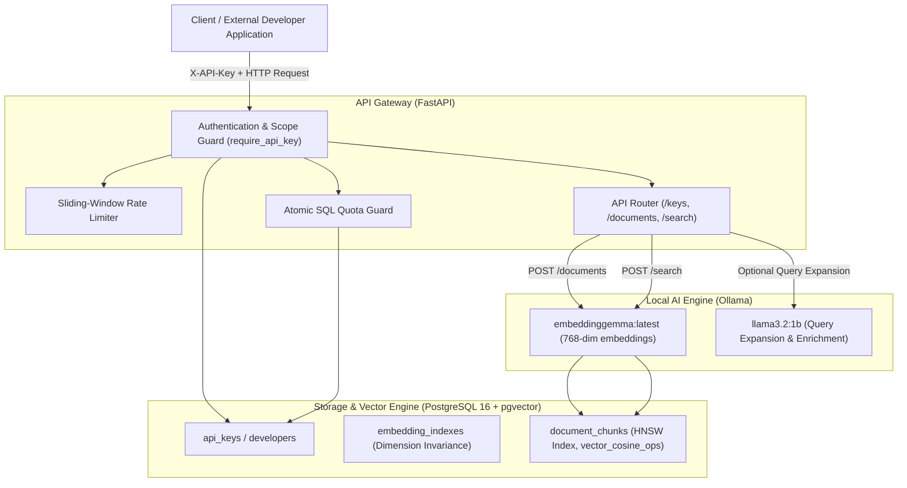

# SemanticVault: Semantic Search as a Service

[](https://www.python.org/downloads/)
[](https://fastapi.tiangolo.com)
[](https://www.postgresql.org/)
[](https://github.com/pgvector/pgvector)
[](https://ollama.com/)
[](https://docs.pytest.org/)

**SemanticVault** is an enterprise-grade Semantic Search as a Service platform built with Python, FastAPI, and PostgreSQL with pgvector. It allows software teams and organizations to upload unstructured documents (PDF, Markdown, TXT), extract clean textual context, generate high-dimensional vector representations with local AI models, and retrieve semantically relevant information with sub-15ms latency.

Rather than merely consuming third-party cloud APIs, SemanticVault provides an independent API product featuring its own multi-tenant developer API key infrastructure, constant-time verification, rolling rate limits, atomic SQL monthly quota tracking, strict vector index dimension compatibility, and Reciprocal Rank Fusion (RRF) hybrid retrieval.

---

## Architecture Overview



---

## Key Engineering Features

- **Custom API Key Infrastructure:**
  - High-entropy cryptographic tokens (`sv_live_...` generated via `secrets.token_hex(24)`).
  - Prefix indexing (`key_prefix`) for $O(1)$ candidate lookup without table scanning.
  - Salted SHA-256 one-way hashing with constant-time verification (`hmac.compare_digest`) to neutralize timing attacks.
  - Granular scopes: `documents:read`, `documents:write`, `search:read`, `admin:keys`, `admin:all`.
  - Instant key revocation and automated expiration validation.
  - Race-condition resistant atomic monthly quota enforcement via conditional SQL updates.
- **Strict Embedding Space Invariance:**
  - Database-enforced `EmbeddingIndex` tracking model name (`embeddinggemma`), version (`v1`), dimension (`768`), and distance metric (`cosine`).
  - Mathematically blocks vector dimension mismatch errors before running queries.
  - Controlled vault re-indexing migration workflows.
- **Document Ingestion Pipeline:**
  - Automated format extraction for PDF (via PyMuPDF), Markdown (structural cleaner), and plain text.
  - SHA-256 content deduplication prevents redundant vector generation and storage waste.
  - Sliding-window chunking engine with configurable chunk sizes, overlaps, and word-boundary preservation.
- **Hybrid Semantic Retrieval:**
  - Dense approximate nearest-neighbor search using pgvector's HNSW graph index (`vector_cosine_ops`).
  - Sparse lexical keyword search.
  - Reciprocal Rank Fusion (RRF) algorithm combining vector and keyword rankings without scale sensitivity:
    $$\text{RRF}(d) = \frac{\alpha}{60 + r_{\text{vector}}(d)} + \frac{1 - \alpha}{60 + r_{\text{keyword}}(d)}$$
  - Optional query expansion and intent rewriting powered by local `llama3.2:1b`.
- **100% Local AI Sovereignty:**
  - Zero cloud dependencies, zero external token billing, and zero customer data egress.
  - Runs on quantized open models via Ollama (`embeddinggemma` + `llama3.2:1b`) with in-process `SentenceTransformers` fallback.

---

## Quickstart Guide

### 1. Start the Database Container
Launch PostgreSQL 16 with the `pgvector` extension pre-installed:

```bash
docker compose up -d db
```

### 2. Configure Local Environment & Models
Ensure Ollama is running and download the local models:

```bash
# Pull local AI models
ollama pull embeddinggemma
ollama pull llama3.2:1b

# Create virtual environment and install dependencies
python -m venv .venv
# On Windows: .venv\Scripts\Activate.ps1
# On Linux/macOS: source .venv/bin/activate
pip install -r requirements.txt
```

### 3. Start the API Server
```bash
uvicorn src.main:app --host 0.0.0.0 --port 8000 --reload
```
Interactive API docs are available at `http://localhost:8000/docs`.

---

## Quick Usage Example (Python)

```python
import httpx

BASE_URL = "http://localhost:8000/api/v1"

# 1. Register Developer & Issue API Key
with httpx.Client(base_url=BASE_URL) as client:
    res = client.post("/keys", json={
        "developer_email": "engineer@example.com",
        "developer_name": "AI Engineer",
        "name": "Production Key",
        "scopes": ["documents:read", "documents:write", "search:read"],
        "monthly_quota": 5000,
    })
    api_key = res.json()["raw_key"]
    print(f"API Key: {api_key}")

# 2. Ingest Document
headers = {"X-API-Key": api_key}
with httpx.Client(base_url=BASE_URL, headers=headers) as client:
    content = "HNSW builds a multi-layer graph for sub-10ms approximate nearest neighbor search."
    files = {"file": ("hnsw_guide.txt", content.encode("utf-8"), "text/plain")}
    
    doc_res = client.post("/documents", files=files, data={"chunk_size": 250, "chunk_overlap": 25})
    print(f"Ingested Document ID: {doc_res.json()['id']}")

    # 3. Hybrid Semantic Search
    search_res = client.post("/search", json={
        "query": "How fast is HNSW nearest neighbor retrieval?",
        "top_k": 3,
        "hybrid": True,
        "similarity_threshold": 0.5,
    })
    
    for result in search_res.json()["results"]:
        print(f"Score: {result['similarity_score']:.4f} | Chunk: {result['content']}")
```

---

## API Route Summary

| Method | Endpoint | Scopes | Description |
| :--- | :--- | :--- | :--- |
| `GET` | `/api/v1/health` | None (Public) | Health check, DB & Ollama connectivity |
| `POST` | `/api/v1/keys` | Public / `admin:keys` | Issue new cryptographic developer API key |
| `GET` | `/api/v1/keys` | `admin:keys` | List active keys for developer |
| `DELETE` | `/api/v1/keys/{key_id}` | `admin:keys` | Instantly revoke an API key |
| `POST` | `/api/v1/documents` | `documents:write` | Upload, parse, chunk, and embed document |
| `GET` | `/api/v1/documents` | `documents:read` | List ingested documents with metadata |
| `GET` | `/api/v1/documents/{id}` | `documents:read` | Retrieve single document and chunk details |
| `DELETE` | `/api/v1/documents/{id}`| `documents:write` | Cascade delete document and vector chunks |
| `POST` | `/api/v1/search` | `search:read` | Execute semantic, hybrid, or filtered search |

---

## Documentation Library

Detailed engineering documentation is located in the [`docs/`](docs/) directory:

- [**System Architecture & Design**](docs/architecture.md): Full component breakdown, request lifecycle, data flow diagrams, and pgvector schema.
- [**Concepts & Core AI Principles**](docs/concepts.md): High-dimensional embeddings, cosine similarity math, HNSW vs. IVFFlat, Reciprocal Rank Fusion, and API security.
- [**Complete API Reference**](docs/api-reference.md): Endpoint specifications, request/response JSON schemas, and curl/Python snippets.
- [**Setup & Deployment Guide**](docs/setup.md): Step-by-step local development setup, Docker container management, and troubleshooting.
- [**Architecture Decision Records (ADRs)**](docs/decisions.md): Technical justifications for pgvector, Ollama, Salted SHA-256, and RRF.
- [**Interview Preparation & Defense**](docs/interview-preparation.md): Battle-tested answers to 10 senior AI engineering questions, scaling walkthrough, and debugging war stories.

---

## Verification & Test Results

The platform is verified with an automated test suite spanning unit, integration, live pgvector, and adversarial security tests:

```text
======================== 51 passed in 4.09s ========================
- test_attack_tampered_key_rejected               PASSED
- test_attack_privilege_escalation_blocked        PASSED
- test_attack_rate_limit_flooding_blocked         PASSED
- test_attack_concurrent_quota_race_condition     PASSED
- test_live_pgvector_cosine_distance_query        PASSED
- test_document_lifecycle                         PASSED
- test_hybrid_search_rrf                          PASSED
- test_controlled_vault_reindexing                PASSED
- test_embedding_model_dimension_validation       PASSED
```

To run tests:
```bash
pytest -v
```

---

## License

MIT License. Designed and engineered for the AI Engineering Portfolio.
