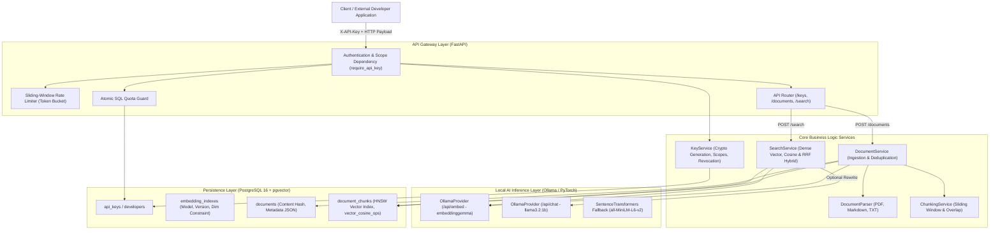
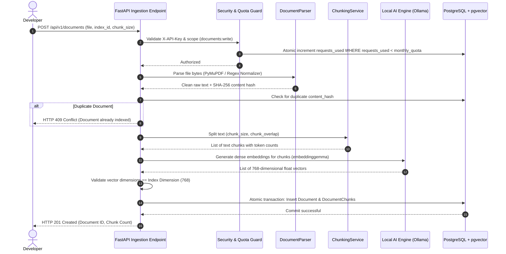
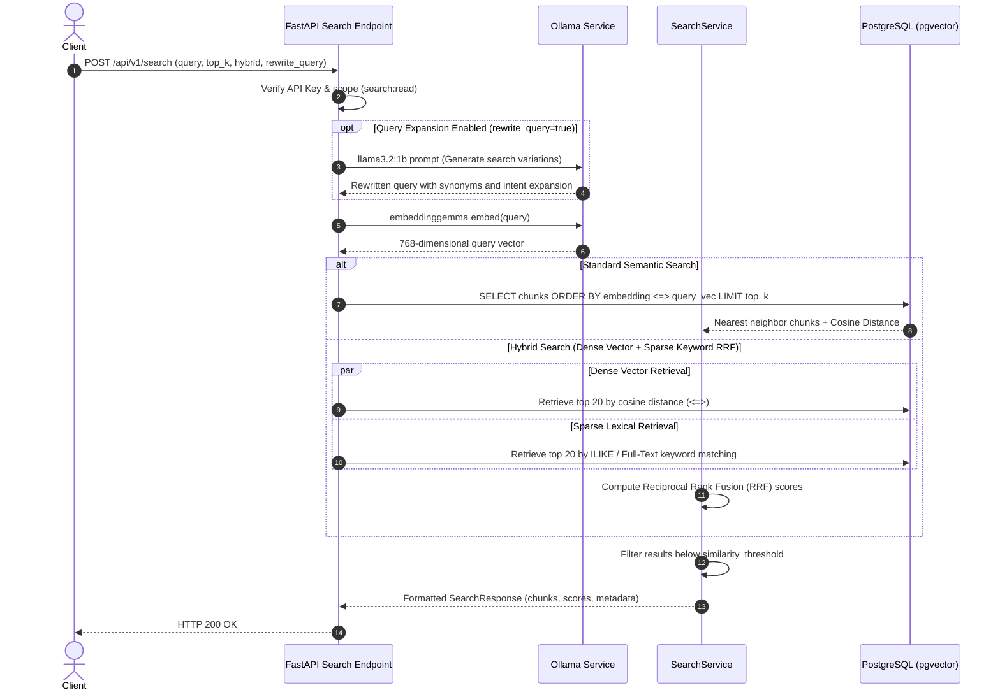

# SemanticVault: System Architecture & Technical Design

## 1. Executive Overview

**SemanticVault** is a developer-facing Semantic Search as a Service platform engineered in Python and FastAPI. It enables organizations and client applications to upload unstructured text, PDF, and Markdown documents, extract and chunk their content, generate high-dimensional vector representations using local embedding models, and retrieve semantically relevant information with sub-second latency.

Unlike superficial vector search wrappers, SemanticVault incorporates enterprise backend guarantees:
- **Strict Vector Index Compatibility:** Enforces model name, version, and dimension boundaries at the database level. Vectors from distinct models or differing dimensions are mathematically prohibited from sharing an index.
- **Cryptographic API Key Infrastructure:** Issues developer API keys hashed via salted SHA-256, verified in constant time, bounded by granular permission scopes (`documents:read`, `documents:write`, `search:read`, `admin:keys`, `admin:all`), rolling rate limits, and atomic SQL monthly quotas.
- **Hybrid Retrieval:** Blends dense vector cosine similarity with sparse lexical search using Reciprocal Rank Fusion (RRF).
- **Local AI Sovereignty:** Powered by Ollama (`embeddinggemma:latest` for 768-dimensional embeddings and `llama3.2:1b` for query expansion and document enrichment), eliminating external cloud dependencies and third-party data egress.

---

## 2. High-Level Architecture Diagram



---

## 3. Document Ingestion Lifecycle

The ingestion pipeline handles raw document upload, format extraction, text normalization, sliding-window chunking, vector embedding generation, and atomic persistence.



---

## 4. Search & Hybrid Retrieval Lifecycle

SemanticVault provides dense semantic vector search, metadata filtering, similarity score thresholds, optional query expansion/rewriting, and Reciprocal Rank Fusion (RRF) hybrid retrieval.



---

## 5. Database Schema & Vector Indexing Design

### 5.1 Relational & Vector Entities

1. **`developers`**: Account entity managing organization identity and billing contact.
2. **`api_keys`**: Cryptographic credentials containing key prefix (for $O(1)$ indexed lookup), salted SHA-256 hash, assigned scopes, expiration timestamp, active status, and monthly usage metrics.
3. **`embedding_indexes`**: Enforces vector space invariance. Tracks model name (`embeddinggemma`), version (`v1`), dimension (`768`), and distance metric (`cosine`).
4. **`documents`**: Parent document entity with SHA-256 `content_hash` for deduplication, extraction metadata, and cascade deletion relationships.
5. **`document_chunks`**: Individual text fragments storing chunk index, token count, text content, and the high-dimensional vector `embedding` column.

### 5.2 HNSW Vector Indexing Architecture

SemanticVault utilizes Hierarchical Navigable Small World (HNSW) graphs in PostgreSQL:

```sql
CREATE INDEX idx_chunks_embedding_hnsw 
ON document_chunks 
USING hnsw (embedding vector_cosine_ops)
WITH (m = 16, ef_construction = 64);
```

- **Distance Metric (`vector_cosine_ops`):** Measures normalized directional similarity:
  $$\text{Cosine Distance}(u, v) = 1.0 - \frac{u \cdot v}{\|u\|_2 \|v\|_2}$$
- **$M = 16$:** Maximum bidirectional links per node in each graph layer. Balances recall accuracy against indexing memory footprint.
- **$ef\_construction = 64$:** Size of the dynamic candidate list during graph construction, guaranteeing high retrieval accuracy on complex semantic manifolds.

---

## 6. Security & Quota Architecture

### 6.1 Cryptographic Key Pipeline
1. **Generation:** 32 bytes of cryptographically secure random entropy (`secrets.token_hex(24)`), prefixed with `sv_live_`.
2. **Prefix Indexing:** The first 16 characters (`sv_live_` + 8 hex chars) are stored unhashed as `key_prefix` to enable $O(1)$ candidate retrieval in the database without scanning table rows.
3. **Salted Hashing:** Stored as $\text{HMAC-SHA256}(\text{key}, \text{salt})$ with a minimum 32-character system salt. Plaintext keys are never logged, cached, or persisted.
4. **Constant-Time Verification:** Key hashes are validated using `hmac.compare_digest` to prevent side-channel timing attacks.

### 6.2 Atomic Concurrency Protection
To prevent race condition attacks where multiple concurrent requests exhaust an API key quota simultaneously, SemanticVault executes atomic SQL updates:

```sql
UPDATE api_keys 
SET requests_used = requests_used + 1 
WHERE id = :key_id AND requests_used < monthly_quota;
```

This guarantees that database engine row-level locks enforce exact monthly quotas without application-level race vulnerabilities.
