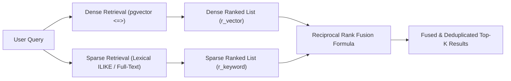

# SemanticVault: Deep-Dive Concepts & Core AI Engineering Principles

This document provides in-depth technical explanations of the fundamental concepts, algorithms, and architectural patterns implemented in SemanticVault.

---

## 1. High-Dimensional Vector Embeddings

### 1.1 What Is an Embedding?
In modern Natural Language Processing (NLP), an **embedding** is a dense numerical vector representation of text in a continuous, high-dimensional vector space ($\mathbb{R}^d$, where $d$ typically ranges from 384 to 1536). Unlike sparse bag-of-words or one-hot encodings where vocabulary size dictates dimensionality and word relationships are lost, dense embeddings place semantically related tokens and sentences close to one another.

### 1.2 Mathematical Formulation of Distance Metrics

When comparing two embedding vectors $\mathbf{u}, \mathbf{v} \in \mathbb{R}^d$, several geometric metrics exist:

#### 1. Dot Product (Inner Product)
$$\langle \mathbf{u}, \mathbf{v} \rangle = \sum_{i=1}^d u_i v_i$$
- **Characteristics:** Sensitive to vector magnitude (length). If embeddings are not unit-normalized, longer text passages with higher magnitude will yield artificially high scores.

#### 2. Euclidean Distance ($L_2$ Norm)
$$\|\mathbf{u} - \mathbf{v}\|_2 = \sqrt{\sum_{i=1}^d (u_i - v_i)^2}$$
- **Characteristics:** Measures absolute physical distance between two points in Euclidean space. A distance of $0$ indicates identical coordinates.

#### 3. Cosine Similarity & Cosine Distance
Cosine similarity measures the cosine of the angle between two non-zero vectors, making it completely invariant to vector magnitude:
$$\text{Cosine Similarity}(\mathbf{u}, \mathbf{v}) = \cos(\theta) = \frac{\mathbf{u} \cdot \mathbf{v}}{\|\mathbf{u}\|_2 \|\mathbf{v}\|_2} = \frac{\sum_{i=1}^d u_i v_i}{\sqrt{\sum_{i=1}^d u_i^2} \sqrt{\sum_{i=1}^d v_i^2}}$$

In vector databases like **pgvector**, search queries order by **Cosine Distance**:
$$\text{Cosine Distance}(\mathbf{u}, \mathbf{v}) = 1.0 - \text{Cosine Similarity}(\mathbf{u}, \mathbf{v})$$
- Range: $[0.0, 2.0]$
- Identical vectors: Distance $= 0.0$ ($\text{Similarity} = 1.0$)
- Orthogonal vectors: Distance $= 1.0$ ($\text{Similarity} = 0.0$)
- Diametrically opposed vectors: Distance $= 2.0$ ($\text{Similarity} = -1.0$)

---

## 2. Vector Indexing: HNSW vs. IVFFlat

Exact Nearest Neighbor (k-NN) search requires computing the cosine distance between a query vector and every single vector in the database ($O(N \cdot d)$ complexity). For large corpora ($N > 100{,}000$), exhaustive flat scans degrade query latency from milliseconds to multiple seconds.

Vector databases solve this using **Approximate Nearest Neighbors (ANN)** indexing.

### 2.1 IVFFlat (Inverted File Flat)
- **Algorithm:** Clusters vectors into $K$ Voronoi partitions using k-means clustering. At query time, the system identifies the nearest cluster centroids (probes) and only scans vectors belonging to those clusters.
- **Trade-offs:** Fast index build times, low memory consumption. However, accuracy (recall) drops significantly if vectors fall near cluster boundaries, and the index requires re-training as dataset distribution drifts.

### 2.2 HNSW (Hierarchical Navigable Small World)
SemanticVault utilizes HNSW via pgvector:
```sql
CREATE INDEX ON document_chunks USING hnsw (embedding vector_cosine_ops) WITH (m = 16, ef_construction = 64);
```

- **Algorithm:** Constructs a multi-layer graph where each layer is a subset of the layer beneath it. The top layer contains sparse, long-range skip links (fast exploration across semantic clusters), while the bottom layer contains dense local links (fine-grained nearest neighbor exploration).
- **Key Parameters:**
  - **$M$ (e.g., 16):** The maximum number of bidirectional edges per node. Higher $M$ increases recall accuracy on high-dimensional data at the cost of higher index memory usage.
  - **$ef\_construction$ (e.g., 64):** The search depth when constructing the graph. Controls index build quality.
  - **$ef\_search$ (e.g., 40):** The query-time exploration depth. Dynamically configurable per session to tune query latency vs. recall.
- **Why HNSW is Superior for Production:** HNSW provides higher recall ($>98\%$) and superior QPS (queries per second) compared to IVFFlat without requiring periodic retraining.

---

## 3. Hybrid Search & Reciprocal Rank Fusion (RRF)

### 3.1 The Limitation of Pure Vector Search
Pure dense vector search excels at conceptual matching (e.g., matching "cardiac infarction symptoms" to "signs of heart attack"), but frequently fails when queries contain exact alphanumeric strings:
- Part numbers or SKU codes (e.g., `RTX-4050-6GB`)
- Method names or API routes (e.g., `test_attack_tampered_key_rejected`)
- Precise personal names or technical terminology

### 3.2 The Hybrid Solution
SemanticVault implements a dual-retrieval pipeline combining **Dense Semantic Vector Search** with **Sparse Lexical Search** using **Reciprocal Rank Fusion (RRF)**:



### 3.3 The Mathematical Formulation of RRF
Given document $d$, its dense ranking $r_{\text{vector}}(d)$, and its lexical ranking $r_{\text{keyword}}(d)$, the RRF score is computed as:

$$\text{RRF}(d) = \frac{\alpha}{k + r_{\text{vector}}(d)} + \frac{1 - \alpha}{k + r_{\text{keyword}}(d)}$$

Where:
- $k$ is a smoothing constant (standard default $= 60$) that prevents top-ranked documents in one list from entirely dominating the combined score.
- $\alpha \in [0.0, 1.0]$ is the fusion weight balancing semantic intuition ($\alpha \to 1.0$) against exact lexical fidelity ($\alpha \to 0.0$). SemanticVault defaults to $\alpha = 0.5$.

---

## 4. Text Chunking & Context Boundary Preservation

### 4.1 Why Chunking Is Mandatory
Large Language Models and embedding architectures possess finite context windows (e.g., 512, 2048, or 8192 tokens). Ingesting entire documents into a single embedding vector causes semantic dilution—critical details get averaged out in high-dimensional space.

### 4.2 Sliding Window Chunking Strategy
SemanticVault implements a sliding window chunking engine with three fundamental properties:
1. **Configurable Chunk Size ($C$):** Target length in characters/words (default: 500 characters).
2. **Chunk Overlap ($O$):** Shared prefix/suffix between adjacent chunks (default: 50 characters). Prevents semantic context from being cleaved across sentence or thought boundaries.
3. **Word Boundary Preservation:** Instead of slicing raw character indices arbitrarily (which corrupts tokens into fragments like `recipr...`), the parser snaps chunk boundaries to whitespace and punctuation delimiters.

$$\text{Stride} = C - O$$

Each consecutive chunk starts at $\text{start}_i = i \times \text{Stride}$, guaranteeing complete coverage with contextual continuity.

---

## 5. API Key Security & Constant-Time Verification

### 5.1 Why Not Plaintext or Symmetric Encryption?
- **Plaintext in Database:** If the database backup or SQL layer is compromised, every developer key is immediately weaponized.
- **Reversible Encryption (e.g., AES-256):** If the application server key is compromised, all developer keys can be decrypted in bulk.
- **Cryptographic One-Way Hashing:** Salted SHA-256 provides irreversible storage. Even with database dump access, the attacker cannot reverse the hash back into the plaintext `sv_live_...` key.

### 5.2 Constant-Time Comparison
Standard string equality (`str_a == str_b`) compares characters sequentially and returns `False` on the first mismatched byte. An attacker measuring HTTP response latency over thousands of requests can determine how many prefix bytes matched (a **timing attack**).

SemanticVault eliminates timing attacks by utilizing `hmac.compare_digest(hash_a, hash_b)`, which always executes in constant time regardless of where mismatches occur.

### 5.3 Prefix Indexing Pattern
Because hashing is one-way, looking up a key requires either:
1. Hashing every key in the database (catastrophic $O(N)$ scan), or
2. Prefix indexing ($O(1)$ lookup).

SemanticVault extracts the first 16 characters (`sv_live_` + 8 hex characters) as a public `key_prefix`. When an API key arrives, the database queries `WHERE key_prefix = :prefix`, retrieving only 1 candidate record for constant-time verification.
